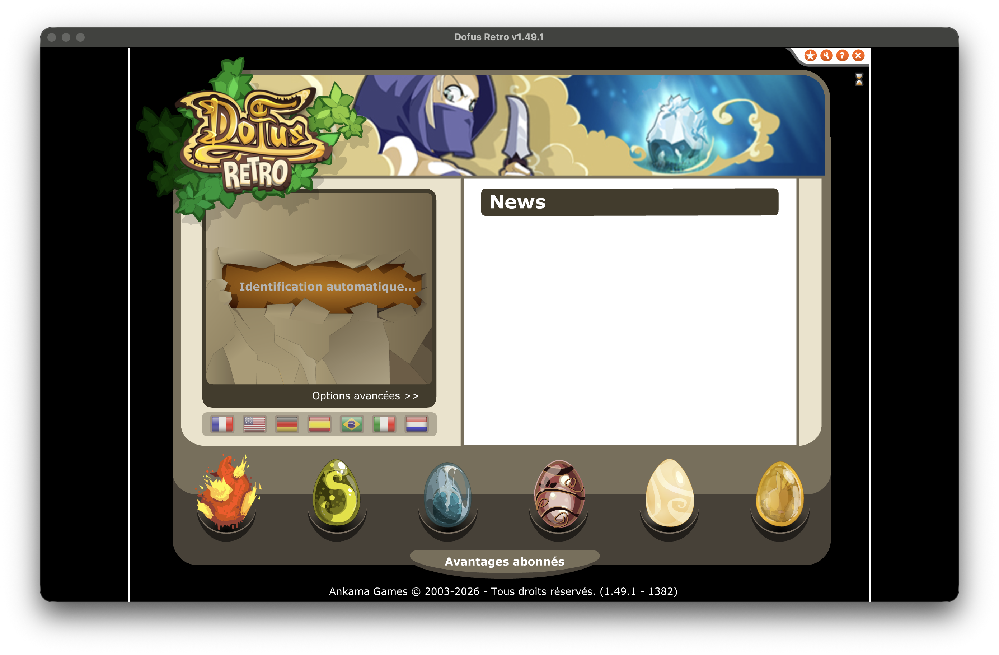

# Dofus Retro native

**DOFUS Retro sur macOS Apple Silicon, nativement, sans Rosetta.** Preuve de concept
remplaçant le plugin Flash x86 par [Ruffle](https://ruffle.rs) dans un shell Electron.
Fonctionne aussi sous Linux et Windows.



> **Périmètre du projet.** Ce dépôt ne contient, ne redistribue et ne modifie aucun
> fichier d'Ankama. Il exécute les SWF d'une **installation officielle** avec un autre
> moteur (Ruffle, natif arm64) à la place du plugin Flash abandonné. La couche
> d'authentification (Zaap) et la couche de sécurité du client n'ont pas été analysées,
> contournées ni réimplémentées : **le client s'arrête à l'écran de connexion.**
> Projet non affilié à Ankama.

## Pourquoi

Le client Retro est une application Electron qui charge `preloader.swf` puis `loader.swf`
via **PepperFlash**, un plugin Intel qu'Adobe ne maintient plus. Sur Apple Silicon, toute
la chaîne tourne donc sous Rosetta.

Apple a annoncé que Rosetta resterait disponible jusqu'à macOS 27, puis serait limitée à
certaines anciennes applications ([source](https://support.apple.com/fr-fr/102527)). À
cette échéance, le client ne se lancera plus en l'état sur un Mac à jour.

Ruffle est une réimplémentation de Flash écrite en Rust, activement maintenue, compilée
en natif pour toutes les architectures et disponible en WebAssembly. Il exécute l'AVM1
(ActionScript 1/2) sur lequel repose Retro.

## État actuel

| | |
|---|---|
| Chargement `preloader.swf` → `loader.swf` | ✅ |
| Rendu, polices, assets, bannières CDN | ✅ |
| Pont `ExternalInterface` (JS ↔ SWF) | ✅ |
| Écran de connexion complet | ✅ |
| Connexion à un compte | ❌ (hors périmètre) |

Le pont fonctionne dans les deux sens sans modifier le code d'Ankama : le SWF appelle
`changeTitle`, et la fenêtre se renomme en « Dofus Retro v1.49.1 ».

## Comment ça marche

```
Electron (arm64 natif)
├─ index.html       : Ruffle (WASM) ──► preloader.swf
│                     stubs ExternalInterface
├─ static-server.js : serveur HTTP du dossier du jeu (lecture seule)
└─ main.js          : pont WebSocket → TCP
```

Trois briques :

1. **Un serveur HTTP local**, intégré à l'app (`static-server.js`), sert le dossier du
   client. Ruffle web ne sait pas charger d'URL `file://`, et un SWF ouvert depuis le
   disque tombe dans le sandbox Flash « local », qui interdit l'accès réseau (d'où le
   message *« configurez DOFUS comme application de confiance »*). Servi en HTTP, le SWF
   passe en sandbox « remote » et les chemins relatifs (`loader.swf`, `clips/`, `data/`)
   se résolvent correctement. Le serveur doit tenir les rafales de requêtes du jeu : voir
   [Assets cassés et lenteur](#assets-cassés-et-lenteur-en-jeu--causes-identifiées).
2. **Un pont WebSocket → TCP** dans `main.js`. Ruffle web ne peut pas ouvrir de socket TCP
   brut : les `XMLSocket` du jeu sont redirigées (option `socketProxy`) vers
   `ws://localhost:8765/<host>/<port>`, que le process principal réouvre en vrai TCP.
3. **Des stubs `ExternalInterface`** dans `index.html`. Le SWF appelle des fonctions
   JavaScript fournies normalement par le client officiel (`getElectronVersion`,
   `changeTitle`, `zaapConnect`, `consoleLog`…). Elles sont exposées ici, journalisées,
   avec des retours neutres. Celles liées à l'authentification et à la sécurité sont
   volontairement vides.

## Prérequis

- DOFUS Retro installé via l'**Ankama Launcher** (le dépôt ne fournit aucun fichier de jeu)
- Node.js 18+

## Installation

```bash
git clone https://github.com/RawZ06/Dofus-retro-ruffle
cd Dofus-retro-ruffle
npm install
```

## Lancement

```bash
npm start
```

L'app sert elle-même le dossier du client officiel, par défaut
`/Applications/Ankama/Retro/Dofus Retro.app/Contents/Resources/app/retroclient`. Pour une
autre installation, indiquez le dossier qui contient `preloader.swf`, `loader.swf` et
`config.xml` :

```bash
RETROCLIENT_DIR="/chemin/vers/retroclient" npm start
```

Le dossier est lu en lecture seule, jamais modifié.

L'écran de connexion de DOFUS Retro doit apparaître. La console de développement liste
les appels `ExternalInterface` sous la forme `[EI] nomFonction(args) -> retour`.

## Dépannage

**« Can't find loader.swf on your game directory »** — le serveur ne sert pas le bon
dossier, ou l'URL de base n'est pas résolue. Vérifiez `RETROCLIENT_DIR` et les lignes
`[http] 404` dans le terminal.

**« Vous devez configurer DOFUS comme application de confiance »** — le SWF est chargé en
`file://` au lieu de `http://`. C'est précisément ce que le serveur statique évite.

**« Impossible de lire le fichier de configuration »** — `config.xml` n'est pas accessible
via le serveur, ou `getUserDataTextFileContent` renvoie `|null|`.

**Electron ne démarre pas (`Library not loaded: Electron Framework`)** — extraction
incomplète du binaire. Réinstallez-le avec `ditto` plutôt qu'`unzip`, qui casse les liens
symboliques des frameworks macOS.

## Assets cassés et lenteur en jeu : causes identifiées

Ankama a signalé deux problèmes avec Ruffle sur Retro : des assets qui ne s'affichent
pas, et une grande lenteur. Ce dépôt s'arrêtant à l'écran de connexion, ils ont été
étudiés sur un client très proche : **WAKFU Les Gardiens 2**, un jeu Flash bâti sur le
même moteur AS2 « Dofus 1.29 » (mêmes classes `ank.*`, même découpage `clips/sprites`,
`clips/items`, même chaîne `accessories.swf` → `a1.swf`…). Les mesures ont été faites en
jeu, avec un compteur de FPS et une mesure du retard des timers injectés dans le client
WLG2. Sur Retro, seule la structure des fichiers a été vérifiée : la même chaîne
d'imports d'accessoires y est présente (`a1.swf` à `a9.swf`).

Quatre causes indépendantes, sans lien entre elles :

| Symptôme | Cause | Où corriger |
|---|---|---|
| Icônes, objets, sorts manquants, différents à chaque fois | Serveur HTTP local saturé | **Corrigé ici** |
| Tout au ralenti, survols et fenêtres avec des secondes de délai | Limite de timers dans Ruffle | Ruffle |
| Saccades, rendu lent | Qualité « haute » forcée par le jeu | Options du jeu |
| Personnages sans leur équipement | Imports chaînés non suivis par Ruffle | Ruffle |

### 1. Assets manquants : le serveur HTTP local

`python3 -m http.server` (utilisé jusqu'ici) n'accepte que **5 connexions en attente**
et répond en HTTP/1.0, avec une connexion par fichier. Un inventaire ou un changement
de carte lance des dizaines de chargements simultanés : les connexions en trop sont
refusées, Ruffle journalise `FetchError("error sending request")` et la case reste vide.
Les cases vides changent à chaque ouverture, ce qui fait croire à un bug de Ruffle.

Mesure sur le dossier `retroclient` (300 requêtes simultanées sur `clips/items`) :

| Serveur | Requêtes servies |
|---|---|
| `python3 -m http.server` | 154 / 300 |
| `static-server.js` (Node, keep-alive, file de 511) | 300 / 300 |

Le client officiel ne rencontre pas ce problème : il charge les fichiers en `file://`,
avec un dossier déclaré « de confiance » auprès du plugin Flash.

### 2. Lenteur générale : limite de timers dans Ruffle

Le moteur cadence presque tout avec `setInterval` : déplacement des personnages via un
timer de 40 ms, infobulles, fenêtres, animations d'interface. Ruffle exécute **au plus 10
callbacks de timer par mise à jour** (`MAX_TICKS = 10` dans
[`core/src/timer.rs`](https://github.com/ruffle-rs/ruffle/blob/master/core/src/timer.rs)).
Au-delà, il ne se contente pas de reporter l'excédent : il **recule son horloge
interne des timers** jusqu'au prochain timer dû. Dès que plus de 10 timers tombent dans
la même image, le retard s'accumule d'image en image.

Mesuré en jeu sur WLG2 : jusqu'à **13 secondes de retard** sur les timers du jeu.
Concrètement, le personnage avance au ralenti et ne court pas, et les survols mettent
des secondes à réagir. Le moteur plafonne en plus chaque pas de déplacement à 50 ms
d'écart, donc un timer en retard fait perdre de la distance au lieu de la rattraper.

Avec la limite relevée à 4000 (binaire `ruffle-desktop` patché pour le test), le retard
retombe à environ 20 ms et le jeu redevient fluide. La correction doit venir de Ruffle :
le cœur est commun aux versions desktop et web (WASM), donc ce dépôt est concerné aussi.

### 3. Saccades : qualité « haute » forcée par le jeu

Au démarrage, le client applique son option de qualité via `_root._quality`, à « high »
par défaut, ce qui **écrase le réglage `quality` de Ruffle**. Sous Ruffle, « high »
signifie un anticrénelage 4x de toute la scène, très coûteux sur un écran Retina : le
thread principal passe l'essentiel de son temps à attendre le GPU. En qualité basse, le
jeu est fluide. Côté utilisateur, il suffit de régler la qualité sur « basse » dans les
options du jeu.

### 4. Personnages sans équipement : imports chaînés

Les sprites de personnages importent leurs accessoires (`ImportAssets`) depuis
`clips/sprites/accessories/accessories.swf`, qui les importe lui-même depuis `a1.swf`…
`a9.swf`. Flash rendait les symboles disponibles à travers toute la chaîne. Ruffle
([`export_assets`](https://github.com/ruffle-rs/ruffle/blob/master/core/src/display_object/movie_clip.rs))
ne les recopie que dans le parent direct, et seulement pour les noms que celui-ci a
importés explicitement. Le sprite n'obtient donc jamais les symboles de `a1.swf`, et le
personnage s'affiche sans son équipement.

Sur WLG2, le contournement a consisté à réécrire les imports des sprites. C'est hors du
périmètre de ce dépôt, qui ne modifie aucun fichier d'Ankama : la correction doit venir
de Ruffle, en résolvant les exports à travers les imports imbriqués.

### Avec `ruffle-desktop`

Deux points de plus, propres à la version desktop :
- **Gros SharedObjects.** Ruffle peut bloquer très longtemps au démarrage en relisant un
  gros SharedObject laissé par une session précédente. `--storage memory` évite le
  problème, mais les options du jeu ne sont plus sauvegardées.
- **Sandbox en `file://`.** En `file://`, le loader refuse de démarrer, car
  `System.security.sandboxType` vaut `localWithFile` au lieu de `localTrusted`.

## Pour l'équipe Ankama

La migration ne demande pas de réécrire le client : il s'agit de remplacer le plugin
PepperFlash (et `flash-player-loader`, plus maintenu depuis ~10 ans) par la dépendance
[`@ruffle-rs/ruffle`](https://www.npmjs.com/package/@ruffle-rs/ruffle) dans le renderer.
`D1ElectronLauncher.js` continue de fonctionner tel quel, le pont `ExternalInterface`
étant supporté.

Il resterait à brancher l'API existante (Zaap, security) sur ce pont, et à router les
`XMLSocket` — soit via un proxy WebSocket comme ici, soit en utilisant `ruffle-desktop`
qui gère le TCP nativement.

Les problèmes d'assets et de lenteur constatés avec Ruffle ont des causes précises (voir
[ci-dessus](#assets-cassés-et-lenteur-en-jeu--causes-identifiées)) :
- les assets cassés viennent du serveur de fichiers, pas de Ruffle ;
- la lenteur vient d'une limite de timers corrigeable dans Ruffle ;
- la qualité par défaut gagnerait à passer à « medium » ou « low » sous Ruffle.

Seuls les imports chaînés d'accessoires demandent une évolution de Ruffle, ou un
regroupement des bibliothèques côté client.

## Licence

MIT. Ruffle est distribué sous licence MIT/Apache-2.0. DOFUS et DOFUS Retro sont des
marques d'Ankama ; ce projet n'est ni affilié à Ankama, ni approuvé par Ankama.
